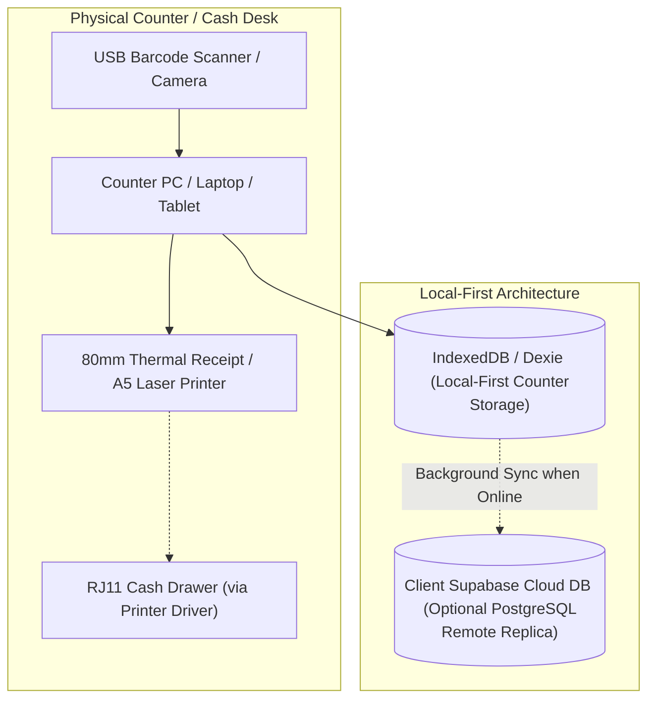

# Client Deployment & Installation Master Guide 🇮🇳
**Target:** White-Label Commercial Handover to Individual Retail Stores  
**System:** WebRajya POS & Billing Engine (Electron Windows Desktop + Local-First PWA)  
**Author:** Software Developer / Vendor  

---

## 1. System Overview & Deployment Architecture

When providing software under **Option A**, you deliver a custom-branded, local-first point-of-sale system to a shop owner.

> [!NOTE]
> **Offline Billing Notice:**  
> The POS is designed to support local billing without an active internet connection. Offline availability depends on successful initial installation and caching, local data availability, and compatible hardware. Verify offline billing, printing, and data recovery during installation.



The system uses a **local-first billing architecture designed for fast counter transactions**. Sales are written directly to local IndexedDB before any network operations take place.

---

## 2. Choosing the Installation Method for Your Client

You have **two deployment formats** available in this codebase:

| Method | Best For | Client Experience | Developer Effort |
| :--- | :--- | :--- | :--- |
| **Method 1: Windows Native Installer (.exe)** | Windows 10/11 Desktop PCs at permanent retail counters. | Double-click setup installer; creates desktop shortcut; opens in dedicated fullscreen window with native silent printing capabilities. | Run `npm run dist:win` to generate `release/WebRajya-Invoice-Setup.exe`. |
| **Method 2: Progressive Web App (PWA)** | Mac, Windows, Linux, Chromebooks, or Android / iPad tablets. | Open URL in Google Chrome / Edge -> Click "Install App" -> App becomes standalone desktop icon without browser address bar. | Deploy to a secure HTTPS host; configure client device browser. |

---

## 3. Method 1: Building & Installing the Windows Desktop App (.exe)

### Step 1: Verify and Run the Build Command
On your development machine, verify the project configuration in `package.json` and run:
```bash
npm run dist:win
```
This script executes:
1. `tsc -b && vite build` (Compiles TypeScript and bundles client assets into `dist/`).
2. `electron-builder --win nsis --x64` (Packages the Electron runtime and NSIS installer).

The output installer is generated at:
`release/WebRajya-Invoice-Setup.exe`

### Step 2: Client Installation (On Counter PC)
1. Copy `WebRajya-Invoice-Setup.exe` to a USB drive or download it directly onto the client's PC.
2. Double-click the installer.
3. Select installation directory (default: `C:\Program Files\WebRajya Invoice POS`).
4. Ensure **"Create Desktop Shortcut"** is selected.
5. Click **Finish**. The application will launch in a dedicated application window.

---

## 4. Method 2: Installing as a PWA (Conditional Verification Guide)

> [!IMPORTANT]
> **PWA Offline Pre-Condition:**  
> An installable PWA is not automatically an offline-capable POS. Before advertising offline operation to a client, you must complete the 7-point verification checklist below.

### Installation Steps
1. Host the built web application on a secure **HTTPS domain** (Service Workers strictly require HTTPS, except on `localhost`).
2. Open Google Chrome or Microsoft Edge on the client's counter computer.
3. Navigate to the hosted POS URL.
4. In the browser address bar, click the **Install icon (⊕)** or open the menu `(...) -> Cast, save, and share -> Install WebRajya POS`.
5. Click **Install**. The POS opens in a standalone window without browser tabs or address bar.

### Pre-Handover Offline Verification Checklist
Before handing over the PWA to the shopkeeper, verify:
- [ ] **Service Worker Caching**: Open DevTools (`F12`) -> Application -> Service Workers. Verify `sw.js` is registered, active, and caching application assets.
- [ ] **Offline Launch Test**: Disconnect the internet cable or turn on Airplane Mode. Close the app completely, reopen it from the desktop icon. Verify it boots into the billing screen.
- [ ] **Local Data Availability**: Verify products and customer records are readable while disconnected.
- [ ] **Offline Transaction Test**: Bill an item, choose cash payment, and click "Complete & Print". Verify the sale saves locally and stock is deducted.
- [ ] **Printing Test**: Verify that physical print output triggers on the connected printer while offline.
- [ ] **Restart Test**: Reboot the computer, launch the app while still offline, and verify that the previously billed invoice appears in the Sales History.
- [ ] **Persistent Storage**: Verify that `navigator.storage.persist()` is granted in the console (`[Storage] Persistent storage granted by browser`).

> [!WARNING]
> Browser storage can be cleared or evicted under extreme operating system disk pressure. While `navigator.storage.persist()` protects IndexedDB on supported Chromium browsers, a weekly JSON export should not be your only protection against data loss. Implement regular off-device backups.

---

## 5. Hardware Configuration & Testing Guide

Hardware peripherals must be verified against actual physical devices before making operational promises.

### 5.1 Thermal Receipt Printer (80mm / 58mm USB / Ethernet)
- **Driver Setup**: Install the manufacturer's POS printer driver (e.g., TVS RP 3200, Epson TM-T82, Xprinter, Everycom).
- **Paper Dimensions**: Configure printing preferences in Windows to match the physical roll width (typically **80mm x 297mm** or **58mm x 210mm**). Set margins to **None / 0mm**.
- **Printing Pipeline Differences**:
  - **In Windows Desktop Electron (.exe)**: The app uses native background spooling via IPC (`print-silent`), printing directly to the default printer without a preview dialog.
  - **In Web / PWA**: The app uses the browser print engine (`window.print()`). For unattended counter printing in Chrome/Edge, configure the desktop shortcut with the `--kiosk-printing` flag.
- **Verification**: Test paper feed, text sharpness, barcode readability, and physical auto-cutter operation.

### 5.2 Cash Drawer (RJ11) Control
- **Connection**: Plug the RJ11 cable from the cash drawer into the thermal printer's "DK / Drawer" port (not into the PC).
- **Trigger Configuration**: In Windows -> `Printers & Scanners -> [Your Thermal Printer] -> Printer Properties -> Device Settings`, set **"Cash Drawer: Open Before Printing"**.
- **Verification**: Print a test receipt and physically verify that the drawer latch kicks open.

### 5.3 A5 Laser / Inkjet Printer
- **Paper Setup**: Load standard A5 paper ($148 \times 210\text{ mm}$) or A4 split into two sheets.
- **Orientation**: Portrait.
- **Layout Specification**: The layout is an **A5 invoice layout designed for similar retail billing workflows** ($140\text{ mm} \times 200\text{ mm}$ printable area).
- **Verification**: Print a sample tax invoice with 3+ items. Physically inspect for edge clipping, line wrapping, GST slab summary clarity, and authorized signature placement.

### 5.4 Barcode Scanner Setup (Handheld USB / Wireless)
- **Emulation**: Ensure the scanner is set to **USB HID Keyboard Emulation** (factory default).
- **Suffix Requirement**: The scanner must be programmed to transmit an **Enter / Carriage Return (CR)** suffix after every scan. Scan the "Add CR/Enter Suffix" barcode from the scanner's user manual.
- **Verification**: Press `F4` to focus the search bar, scan a product barcode. Verify that the item immediately populates the cart and advances the cursor to the quantity field.

### 5.5 Camera-Based Barcode Scanning (Tablets / Laptops)
- **Prerequisites**: Requires an active camera sensor and browser HTTPS permissions.
- **Verification**: Click the Camera icon in POS. Verify that the browser camera permission dialog appears, the video stream initializes, and standard EAN-13 / Code-128 barcodes decode under counter lighting.

---

## 6. Client White-Label Onboarding & Invoice Series Setup

### 6.1 Shop Profile Configuration
In **Settings (`F10`)**, configure:
- **Shop / Legal Name**: Exact registered trade name.
- **Tagline**: Retail trade description.
- **Address & State**: Full address with 2-digit State Code (e.g., `Madhya Pradesh (23)`).
- **GSTIN**: 15-character GST identification number (or leave blank if composition/unregistered).
- **Bank Details & UPI ID**: Account number, IFSC code, and VPA for dynamic on-bill QR payment.
- **Terms & Conditions**: Shop return and dispute policies.

### 6.2 Statutory Invoice Numbering Rules (CGST Rule 46(b))
> [!IMPORTANT]
> Under Indian GST statutory provisions, invoice serial numbers must be **consecutive**, **unique for a financial year**, and may contain only alphabets, numerals, and special characters hyphen (`-`) and slash (`/`).

**Configuring the Invoice Series**:
1. In Settings, define a prefix that includes the financial year identifier:
   - Example for FY 2026-27: `INV-26-` or `CTC-26-` or `SHOP/26/`.
2. The system automatically appends a 5-digit sequential counter (e.g., `INV-26-00001`, `INV-26-00002`).
3. **Collision-Free Check**: Test generating two consecutive invoices. Verify that the numbering increments monotonically and that existing numbers cannot be overwritten.
4. **Financial Year Rollover**: When a new financial year begins (1st April), update the prefix (e.g., `INV-27-`) to reset the sequence legally.

---

## 7. Supabase Cloud Sync & Security Configuration

If remote multi-device access or cloud replication is requested by the client:

### 7.1 Security & Access Control Checkpoints
Before deploying Supabase credentials to any client:
1. **Row Level Security (RLS)**: Verify that RLS is enabled on all tables in Supabase (`invoices`, `invoice_items`, `products`, `customers`, `stock_movements`).
2. **Access Policies**: Ensure policies restrict read/write access appropriately so unauthenticated third parties cannot query or tamper with data.
3. **Key Isolation**: **NEVER** distribute the Supabase `service_role` secret key. The frontend, PWA, and Electron app must use **ONLY the public `anonKey`**.
4. **Tenant Isolation**: Each commercial client must have their own independent Supabase project and database instance. Do not mix competing stores in a single project without strict multi-tenant RLS filters.
5. **Conflict Handling**: Sync uses idempotent upserts on unique primary IDs. Remote edits or cancellations do not wipe local offline transaction history.
6. **Commercial Ownership**: Clearly agree in writing whether the Supabase account is owned and paid for directly by the client or billed through your annual maintenance contract (AMC).

> [!WARNING]
> Do not describe cloud synchronisation as a backup. Cloud synchronization is live data replication. If a record is altered or marked cancelled, that status replicates to the cloud. Independent frozen backups (JSON exports) are required for disaster recovery.

---

## 8. Backup & Data Protection Routine (Client SOP)

Train the store owner on the dual-protection recovery workflow:

### Step 1: Automated Local Shield
The app maintains data locally in persistent IndexedDB. The header displays an alert if no backup has been taken in 7 days.

### Step 2: Weekly Sovereign JSON Export
1. Every Saturday or Sunday after closing the cash counter, open **Settings (`F10`) -> Data Backup**.
2. Click **"Download JSON Database Backup"**.
3. Save the exported `.json` file to an external USB pen drive or email it to an off-premise account.
4. The backup file contains the complete business state: products, stock ledgers, past invoices, customer khata balances, and shop settings.

### Step 3: Disaster Recovery Procedure
If the counter PC fails:
1. Set up WebRajya on the replacement PC.
2. Go to **Settings -> Backup -> Click "Restore from JSON Backup"**.
3. Select the latest backup file.
4. All product catalogs, customer balances, and invoice records are restored into the fresh database in one atomic transaction.

---

## 9. Counter Troubleshooting & Emergency SOP

When unexpected issues occur at the billing counter, follow these step-by-step resolution procedures:

### Problem 1: Internet Stops Working / Wi-Fi Drops
- **Symptom**: Network indicator in Windows or browser turns disconnected.
- **Action & Verification**:
  1. **Do not stop billing**: WebRajya is engineered as a local-first system. All products, prices, barcodes, and customer records reside in local counter storage (IndexedDB).
  2. Continue scanning items and issuing bills as normal. The top bar may display an offline notice, but billing, GST calculations, and receipt printing function without disruption.
  3. All offline transactions are assigned unique sequential numbers and queued locally. Once internet connectivity is restored, the system automatically replicates pending records to the cloud in the background.

### Problem 2: Computer Shuts Down Unexpectedly (Power Outage / Accidental Unplug)
- **Symptom**: The computer powers off while a bill was being prepared or immediately after clicking print.
- **Action & Verification**:
  1. Restart the computer and launch WebRajya.
  2. **Check Last Transaction**: Press `F3` or navigate to **Sales History**. Inspect the top entry in the sales table.
     - If the bill is present with status `PAID`, the transaction was committed to the local database before shutdown. If the customer is waiting, click **Reprint (`Ctrl + P`)**.
     - If the counter shut down *during* cart entry before payment: Click **"Hold / Drafts"** on the main billing screen. WebRajya auto-saves in-progress carts to local storage. Select the draft to restore all previously entered items without re-scanning.

### Problem 3: Thermal Printer Stops Responding
- **Symptom**: Cashier clicks "Complete & Print", but no receipt emerges from the thermal printer.
- **Action & Verification**:
  1. **Physical Checks**:
     - Check printer power switch and LED indicator (must be solid green/blue, not flashing red).
     - Verify paper roll is not exhausted and is facing the correct thermal direction (thermal side facing print head).
     - Verify USB cable is firmly connected to both printer and PC.
  2. **Settings Check**: Press `F10` (Settings) -> Under **Print Settings**, verify Paper Size is set to `80mm Thermal` (or `58mm`).
  3. **Windows Spooler Clearance**:
     - Open Windows Start -> Type `Printers & scanners` -> Click your thermal printer.
     - Check queue status: If it shows *"1 document pending / Error"*, click **Open queue -> Printer menu -> Cancel All Documents**.
     - Turn printer power OFF for 5 seconds, then turn ON.
  4. **Perform Test Print**: In WebRajya Settings, click **"Test Print"**. If a test receipt prints, return to Sales History and reprint the customer bill.

### Problem 4: Barcode Scanner Fails / Not Reading Items
- **Symptom**: Scanner beeps when pointing at a barcode, but nothing appears on screen.
- **Action & Verification**:
  1. **Check Input Focus**: The computer cursor must be focused inside an input field. **Press `F4`** — this instantly snaps cursor focus to the product search / barcode field. Scan the item again.
  2. **Verify Hardware Mode**: Handheld scanners must be set to **USB HID Keyboard Emulation**. Unplug and replug the USB cable into a different USB port on the PC.
  3. **Enter / Carriage Return Suffix**: If the scanner types the barcode number into the box but does not automatically add the product to the cart, the scanner is missing the Enter key command. Open the scanner's user manual and scan the programming barcode labelled **"Add Enter / CR Suffix"**.
  4. **Diagnostic Test in Notepad**: Open Windows Notepad. Scan any physical product barcode. If the barcode number types into Notepad and the cursor jumps to the next line, the scanner hardware is functioning properly.

### Problem 5: Cloud Sync Fails / Red Warning Indicator
- **Symptom**: An in-app notice indicates *"Sync Failed"* or cloud connection error.
- **Action & Verification**:
  1. **Counter Safety**: Local counter billing is **never blocked** by cloud sync failures. Cashiers can continue billing customers.
  2. **Manual Sync Attempt**: Go to **Sales History** -> Click the **"Sync Cloud"** button (refresh icon). The app will re-attempt to push any unsynced local invoices.
  3. **Verify Supabase Credentials**: Open **Settings (`F10`) -> Supabase Cloud Sync**. Check that the Project URL and Public Anon Key have not been altered. Click **"Test Connection"**.
  4. **Important Safeguard**: Never clear browser cookies or reset database while local invoices are marked as pending sync.

### Problem 6: Local Database Lost or Browser Data Cleared
- **Symptom**: Products catalog appears empty or past sales history is missing after running a PC cleaner utility.
- **Action & Verification**:
  1. Locate the most recent weekly JSON backup file (from your USB backup pen drive or email).
  2. Open WebRajya POS -> Press `F10` (Settings) -> Select the **Data Backup** tab.
  3. Click **"Restore from JSON Backup"** and select the `.json` file.
  4. **Validate Restored State**: Check the Products section to confirm item counts, inspect Sales History, and verify Customer Khata balances.
  5. If cloud sync was active, clicking **"Sync Cloud"** in Sales will also pull down any cloud-replicated invoices.

### Problem 7: Counter Computer Replaced or Upgraded
- **Symptom**: Migrating the POS system to a new desktop PC or replacement machine.
- **Action & Verification**:
  1. On the new computer, install WebRajya POS using `WebRajya-Invoice-Setup.exe` (or open Chrome/Edge and click "Install App" for PWA).
  2. Connect the printer and barcode scanner; install manufacturer printer drivers.
  3. Open WebRajya -> Press `F10` -> Click **"Restore from JSON Backup"** -> Select your latest backup file from the old PC.
  4. **Mandatory Acceptance Check Before Billing Customers**:
     - Scan 1 product with the barcode scanner.
     - Create a test bill for ₹10.
     - Print an 80mm receipt and an A5 tax invoice.
     - Issue a Credit Note return for the test bill to ensure inventory restocks properly.

### Problem 8: Client Requests Developer / Technical Support
When an issue cannot be resolved through the steps above, the store owner should contact official support:

- **Support Contact Channel**:
  - **Phone / WhatsApp**: `+91 9630013483`
  - **Email**: `aryanrajput835@gmail.com`
  - **Remote Support**: AnyDesk / TeamViewer (instant screen assistance)
- **Standard Support Hours**: Monday to Saturday, 10:00 AM – 8:00 PM IST  
  *(Critical counter-down emergency response target: within 1 hour)*
- **Information Client Should Provide**:
  1. Shop Name and Counter PC identifier.
  2. Exact description of the issue and a photo of the counter screen.
  3. The specific action being performed (e.g., scanning item, clicking print, saving draft).
  4. 9-digit AnyDesk ID for remote desktop connection.

---

## 10. Handover-Day Protocol & Release Gates

To ensure a defensible, professional release and avoid post-handover disputes, execute these three release gates before requesting final payment:

### 10.1 Three Non-Negotiable Release Gates Before Final Payment

#### Gate A: In-Store Offline Billing Verification (Live at Counter)
Do not rely solely on developer-machine tests. Complete this on the client's actual counter:
1. Open the installed application while internet is connected. Confirm product catalog and shop settings load.
2. Disconnect the internet (unplug Ethernet or disable Wi-Fi).
3. Create a test bill with 1 product, tender cash, and verify that inventory stock decreases.
4. Close and reopen the application while still completely offline.
5. Confirm the application boots, past sales are visible in Sales History, and product records remain accessible.
6. Reconnect the internet. If cloud sync is enabled, verify that the offline bill syncs without creating duplicates.
*(Important: Remind the client that browser storage can be cleared by disk cleanup utilities, so regular off-device backups remain essential).*

#### Gate B: Backup Verification on a Clean Database
1. Create a real test sale in the store's POS.
2. Export a fresh JSON backup to the client's external USB drive.
3. Open a separate browser profile / test device and click **"Restore from JSON Backup"**.
4. Check that products, invoices, stock movements, customer Khata balances, and settings restore accurately.
5. Confirm that restoring does not create duplicate invoice numbers or break parent-child item relationships.
6. Always keep a separate copy of the JSON backup before performing any destructive tests.

#### Gate C: Physical Printed Document Inspection
Print a test bill using the client's own physical printer (thermal or A5) and verify with the owner:
- **Header**: Shop name, registered address, and GSTIN (if applicable).
- **Metadata**: Invoice number series and current date/time.
- **Line Items**: Product description, HSN code, unit (Pcs/Box), rate, discount, and total.
- **Taxes**: Statutory GST slab summary table (CGST, SGST, IGST) and round-off calculation.
- **Layout & Readability**: Paper margins, text sharpness, cutter operation, and zero edge clipping.
- **Credit Note Check**: If returns are in scope, test 1 sales return and verify the Credit Note references the original invoice number and date.
*(Note: Recommend that the store owner review the printed tax layout with their Chartered Accountant to verify classification for their specific trades).*

---

### 10.2 Handover-Day Execution Sequence

#### Stage 1: Before Leaving Your Office
- [ ] Prepare the correct client-branded installer or PWA deployment URL.
- [ ] Confirm the agreed software version (`v1.0.0`).
- [ ] Pack a USB drive containing the installer, deployment guide, and sample backup.
- [ ] Print two copies of the signed Agreement draft ([`docs/WHITE_LABEL_COMMERCIAL_AGREEMENT.md`](./WHITE_LABEL_COMMERCIAL_AGREEMENT.md)).
- [ ] Print Schedule B (Software Delivery & Acceptance Certificate).
- [ ] Print the Keyboard Shortcuts Cheatsheet (`F2`, `F4`, `F8`, `F9`).
- [ ] Verify the final milestone payment amount matches the contract.

#### Stage 2: At the Client's Store
- [ ] Install the application on the counter PC.
- [ ] Configure the shop profile (Trade name, address, GSTIN, bank details, UPI ID).
- [ ] Connect and calibrate the barcode scanner (verify Enter/CR suffix).
- [ ] Configure and test the thermal/laser printer.
- [ ] Execute Gate A (In-store offline billing test).
- [ ] Execute Gate B (Backup export to client's USB drive).
- [ ] Execute Gate C (Inspect physical printed bill with store owner).
- [ ] Conduct 20-minute cashier training on billing shortcuts and return handling.
- [ ] Record any minor client requests or agreed pending items.
- [ ] Obtain the store owner's signature and shop stamp on Schedule B (Acceptance Certificate).
- [ ] Collect the remaining balance payment according to the agreement.

#### Stage 3: Post-Handover Wrap-Up
- [ ] Provide the client with their signed copy of the Agreement and Acceptance Certificate.
- [ ] Deliver the backup routine instructions and tape the shortcut cheatsheet near the counter monitor.
- [ ] Log the delivered version, hardware models, and handover date in your project records.
- [ ] Confirm the 90-day warranty period and official support channels in writing.


